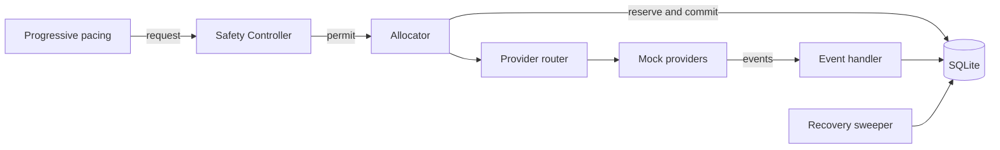

# SmartDialer

SmartDialer pairs a borrower with an available agent before placing a call.
Several dispatchers can compete for the same agent and borrower.
A single-use permit bounds how many calls each dispatcher may reserve.
Provider events can arrive late, arrive twice, or skip steps.
SQLite records the assignments, call history and safety decisions that let a replacement worker recover.

## Quickstart

Clone the repository and open its root directory. With Python 3.11 on Windows PowerShell:

```powershell
python -m venv .venv
.\.venv\Scripts\Activate.ps1
python -m pip install -e '.[dev]'
```

On macOS or Linux:

```sh
python3.11 -m venv .venv
source .venv/bin/activate
python -m pip install -e '.[dev]'
```

Start with `make test demo` to run the suite and see the five failure timelines. On Windows with MinGW, use `mingw32-make` in place of `make`.

| Run | With Make | With Python |
|---|---|---|
| Tests | `make test` | `python -m pytest -q` |
| Failure demos | `make demo` | `python -m pytest -s tests/scenarios` |
| Six simulated shifts | `make sim` | `python -m smartdialer.simulator` |
| Eight-process benchmark | `make load` | `python scripts/loadtest.py` |

## How a call gets placed



Follow a call through the [architecture](docs/architecture.md) and [state machines](docs/state-machines.md). The [architecture decisions](docs/ADR.md) explain the trade-offs. The [simulation results](docs/simulation-results.md) and [scale notes](docs/scale.md) give the measurements. The implementation sequence is in the [build plan](plan.md).


## Failure scenario demos

Run `make demo` (Windows MinGW: `mingw32-make demo`) or `python -m pytest -s tests/scenarios` from the activated environment. Each demo prints elapsed virtual time and checks the resulting database and provider state.

| Scenario | Timeline from a demo run |
|---|---|
| Worker crash | At 0 s A accepts a placement and the dispatcher process is killed before recording initiation. At 10.001 s the next worker polls A and resumes the call. At 24.001 s the borrower is done and A has placed exactly one call. |
| Provider outage | At 2.250 s B rejects new calls and A accepts the next placement. At 3.450 s both breakers are open, two agents remain available, and failed borrowers have jittered retry deadlines. At 13.451 s polling recovers the lost completion and B accepts a recovery probe. |
| Agent drop | At 0 s safety approves 100 calls. At 5.000 s 40 agents reach their heartbeat deadline. The 5.200 s tick approves 60 calls and marks 40 agents offline. |
| Duplicate events | By 0.500 s the same answer notification has arrived five times. One delivery advances the agent and four return a duplicate outcome. |
| Out-of-order events | Completion at 0.100 s applies the implied transitions. The answer at 0.200 s and ringing at 0.300 s are stale. The borrower is done and the agent is in wrap-up. |

## Progressive dialing simulation

Run `make sim` to replay six eight-hour shifts using virtual time. For a shorter run, use `python -m smartdialer.simulator --seconds 900 --output short-run.md`. The simulator uses the same dispatcher, reservation transactions, safety checks, provider events and recovery sweeper as the demos.

At a 20% answer rate, progressive dialing takes about five attempts per answer. With 20 seconds of ringing per attempt, 120 seconds of conversation and 30 seconds of wrap-up, scenario A measured 48.23% talk utilization. The clean-model estimate is 48% from `120 / (120 + 30 + 20 / 0.20)`. Predictive dialing could reclaim some of that waiting time by starting calls earlier. It requires a safety controller because several borrowers can answer before enough agents become available. See the [measured scenario results](docs/simulation-results.md) for utilization, pacing, safety decisions and abandoned calls.

## SQLite load test

Run `make load` or `python scripts/loadtest.py` from the activated environment. The benchmark creates temporary WAL databases, exercises 100 and 1,000 agents with eight worker processes, and writes the measurements to [docs/scale.md](docs/scale.md). Each run seeds 100,000 borrowers and replays 100,000 state-changing events.

## Known limitations

- Workers share one SQLite database on one machine. WAL supports concurrent readers and serializes writers. The load test measures short bursts on one host.
- Both providers simulate calls. Their call histories live in memory. Recovery across a dispatcher restart assumes the provider service can still answer status queries.
- The allocator implements progressive dialing. Its calling window uses one configured borrower timezone per campaign.
- An agent can disconnect after a borrower answers. Recovery records this as an abandonment incident. Scenario F measured three such calls.

## Ground rules

1. Put correctness first. A double-booked agent is worse than a missing dashboard.
2. Make every state change a conditional write such as `UPDATE ... WHERE state = :expected` and check `rowcount`. Always guard a write that follows a read.
3. Guard agent updates with `current_call_id` as well. A late or stale release must leave an agent's newer call assignment intact.
4. Keep provider calls outside database transactions. Reserve, commit, then call the provider.
5. Move state forward only. Duplicate, stale, and reordered events that would move state backward are no-ops.
6. Get all business-logic time from an injected `Clock` so the simulator and crash tests are deterministic.
7. Pacing can request capacity. Only the Safety Controller can issue a `Permit`, and only the allocator can reserve and place calls with one.
8. Fail closed. Reject a request whenever the Safety Controller cannot establish that it is safe.
9. Document the problem a new technology solves before adding it.
