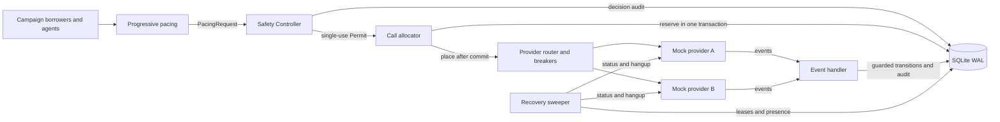

# Architecture

Each dispatcher owns a SQLite connection and runs a jittered tick roughly every 200 ms. All workers serving a campaign can see its durable reservations, permits and provider bindings.

## Follow one call

1. **Request.** The dispatcher reads a campaign snapshot. Progressive pacing requests one call per available agent with a fresh heartbeat. The controller checks the campaign pause and global kill switch, local calling hours, snapshot freshness, breaker health, provider concurrency and calls per second. It writes the input, reason codes and decision to SQLite. A positive approval produces a permit.
2. **Reserve.** The allocator consumes the permit in the same write transaction that pairs agents with eligible borrowers. It claims each agent and borrower conditionally and creates a leased call with an idempotency key. The transaction commits before placement.
3. **Place.** Before each provider attempt, the allocator rechecks admission, records the provider binding and debits rate capacity. It then calls the provider outside the transaction. A definite rejection permits failover. A timeout allows two retries against the same provider and key. If the outcome remains ambiguous, the reservation survives for reconciliation.
4. **Apply events.** The event handler writes the notification and advances the call, agent and borrower together. A fast ringing notification can advance the call before placement returns. The later initiation acknowledgement then leaves it at ringing. See the [transition examples](state-machines.md).
5. **Recover.** About once a second, a worker checks expired leases, ring deadlines, quiet connected calls, heartbeat deadlines and wrap-up. It polls the bound provider outside the transaction and rechecks the assignment or call version before settling. A pending hangup is durable and can be retried by another worker. A lost connected agent produces an incident in the same transaction as settlement.

## Where to look

| Question | Implementation and evidence |
|---|---|
| Why was dialing reduced? | Inspect `safety_decisions` and its input snapshot. [Safety](../src/smartdialer/safety.py) |
| Who won the reservation? | Inspect `calls`, `agents.current_call_id` and `borrowers.active_call_id`. [Repository](../src/smartdialer/repository.py) |
| What happened after a timeout? | Follow the persisted provider, lease and event audit for that call. [Router](../src/smartdialer/router.py) and [recovery](../src/smartdialer/recovery.py) |
| Which state survives a crash? | Database assignments and audit rows persist. Breakers and mock provider histories live in memory. [Crash demo](../tests/scenarios/test_worker_crash.py) |
