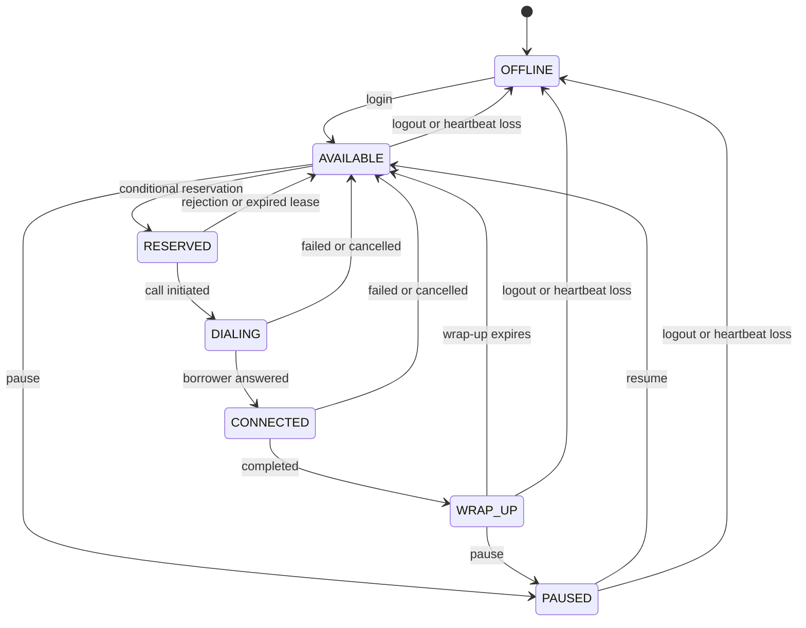
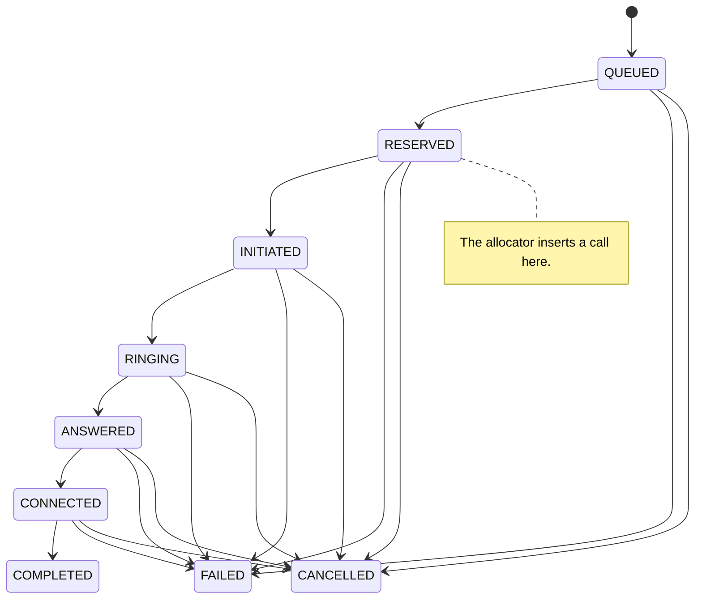

# State machines

## Agent availability

The diagram shows ordinary transitions. A busy agent's pause request sets `pending_state`. At release it overrides the usual available or wrap-up destination. Explicit logout and heartbeat loss settle the busy assignment immediately and take the agent offline. Loss while connected also creates an `ABANDONED_AGENT_LOST` incident.

## Call progression

The planner fills every missing forward step. Failure and cancellation jump directly from any nonterminal state. All three terminal states absorb later events. An agent becomes connected when the call reaches `ANSWERED`.

| Event arrives | Current call state | Result |
|---|---|---|
| Previously recorded provider and event ID | Any | Return `DUPLICATE`. The first audit row and its effects stand. |
| New event for an unknown call ID | No call row | Record `UNKNOWN_CALL`. |
| `RINGING` before the placement acknowledgement | `RESERVED` | Apply initiation and ringing. The agent becomes dialing once. |
| `ANSWERED` | `RINGING` | Connect the agent and set the borrower to `IN_CALL`. |
| Repeated `ANSWERED` without an event ID | `ANSWERED` | Record `STALE`. Agent version stays unchanged. |
| `COMPLETED` | `INITIATED` | Fill ringing, answered and connected, then complete. Clear assignments, mark borrower done and normally start 30 s wrap-up. |
| Late ringing, answer or failure | `COMPLETED` | Record `STALE`. |
| `FAILED(NO_ANSWER)` or `FAILED(BUSY)` | `RINGING` | Release the agent and consume one borrower attempt. Retry in two hours, or mark exhausted at the attempt limit. |
| Provider failure or cancellation | Active call | Release the matching assignment. Requeue with a 2–5 s delay and preserve the attempt count. |

Each applied step checks the expected call state and version. Agent and borrower writes also check the assignment ID. The event audit commits with those writes, so a rollback permits safe redelivery. [Transition planner](../src/smartdialer/models.py) and [event-handler tests](../tests/test_event_handler.py)
