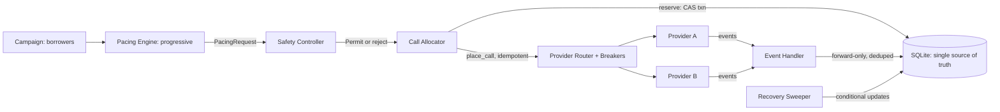
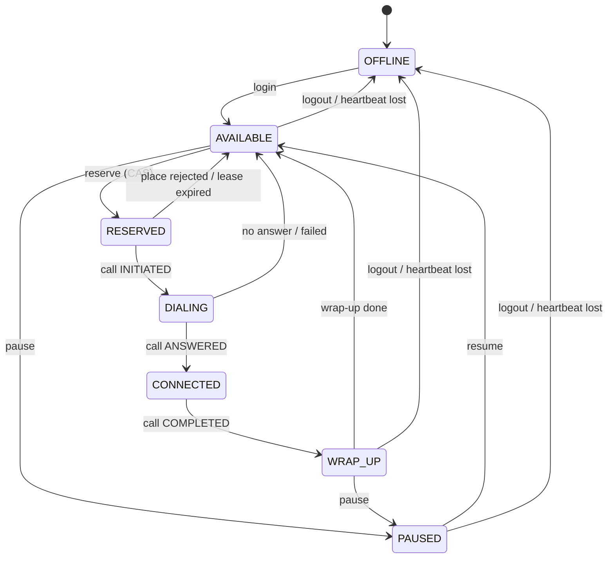
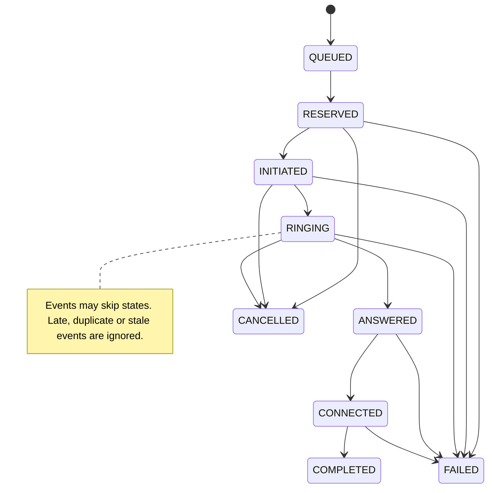

# SmartDialer (Progressive Mode): Build Plan

How to use this file: start from an empty folder and work top to bottom. Each phase has a goal, the exact files, the steps, the tests, and a **Done when** line. Don't start the next phase until the current one is green and committed. One commit per phase.

**Stack:** Python 3.11, SQLite (WAL), standard library only, plus `pytest`.
**Why this stack:** the hard part of this assignment is atomic state changes, not infrastructure. One SQL database gives atomic conditional updates, a single source of truth (no "DB says AVAILABLE, cache says RESERVED"), and real multi-process workers. No Kafka, no Redis.
**What it makes harder:** SQLite has one writer at a time. Postgres is the production target and every SQL pattern below maps to it directly (`FOR UPDATE SKIP LOCKED`).

---

## 0. Ground rules (write these in the README first, then obey them)

1. **Correctness before features.** A double-booked agent is worse than a missing dashboard.
2. **Every state change is a conditional write** (`UPDATE ... WHERE state = :expected`) and the code checks `rowcount`. Never read-then-write without a guard.
3. **Agent updates are also guarded by `current_call_id`**, so a late or stale release can never free an agent that has since been given a new call.
4. **Never hold a DB transaction across a provider call.** Reserve, commit, then call the provider.
5. **State only moves forward.** Duplicate, stale, and reordered events are no-ops.
6. **All time comes from an injected `Clock`.** No `time.time()` in business logic. This is what makes the simulator and the crash tests deterministic.
7. **Pacing can only ask. Only the Safety Controller can issue a `Permit`. Only the allocator, with a `Permit`, can reserve and place.**
8. **Fail closed.** If safety can't prove it's safe, it rejects.
9. **Don't add technology without writing down what problem it solves.**

---

## 1. Time budget

| Phase | What | Est. |
|---|---|---|
| 0 | Bootstrap repo | 15 min |
| 1 | State machines | 30 min |
| 2 | Clock, schema, DB helpers | 30 min |
| 3 | Atomic reservation + race tests | 45 min |
| 4 | Providers, circuit breaker, router | 45 min |
| 5 | Event handler (idempotent, forward-only) | 40 min |
| 6 | Pacing, Safety Controller, allocator, dispatcher | 50 min |
| 7 | Recovery sweeper + agent presence | 40 min |
| 8 | Failure scenario demos | 25 min |
| 9 | Simulator and scenarios | 40 min |
| 10 | Load test | 20 min |
| 11 | Docs and diagrams | 45 min |
| 12 | Final review and interview prep | 15 min |
| | **Total** | **about 6.5 h** |

If you're short on time, see the **cut list** in section 14. Never cut phases 1 to 7. They are 60% of the grade.

---

## Phase 0: Bootstrap (15 min)

```bash
mkdir smartdialer && cd smartdialer
git init
python3.11 -m venv .venv && source .venv/bin/activate
pip install pytest ruff
mkdir -p src/smartdialer/providers tests/scenarios docs scripts
touch src/smartdialer/__init__.py src/smartdialer/providers/__init__.py
```

Create `pyproject.toml` (package under `src/`, pytest `pythonpath = ["src"]`) and a `Makefile`:

```make
test:  ; pytest -q
sim:   ; python -m smartdialer.simulator
load:  ; python scripts/loadtest.py
demo:  ; pytest -s tests/scenarios
```

Target layout:

```
smartdialer/
  README.md  plan.md  Makefile  pyproject.toml
  src/smartdialer/
    clock.py            # Clock, SystemClock, FakeClock
    models.py           # enums + transition tables + pure transition planner
    schema.sql
    db.py               # connect(), tx() context manager, init_schema()
    repository.py       # ALL SQL lives here (reserve, release, apply, queries)
    providers/
      base.py           # Provider protocol, ProviderEvent, PlaceResult
      mock_a.py         # fast, reliable
      mock_b.py         # slow, timeouts, duplicates, reordering, lost events
    breaker.py          # CircuitBreaker
    router.py           # ProviderRouter (health-aware, failover)
    event_handler.py    # idempotent provider-event processing
    pacing.py           # ProgressivePacing (can't import allocator/providers)
    safety.py           # SafetyController + Permit
    allocator.py        # reserve (with Permit) + place
    dispatcher.py       # the tick loop
    recovery.py         # sweeper + agent presence
    simulator.py  scenarios.py
  scripts/loadtest.py
  tests/  (see each phase)
  docs/   architecture.md  state-machines.md  ADR.md  scale.md  simulation-results.md
```

**Done when:** `pytest` runs (0 tests) and `git commit -m "chore: bootstrap"` is done.

---

## Phase 1: State machines (30 min)

**Goal:** the agent and call lifecycles exist as pure code with no DB. Everything else is built on these.

**File:** `src/smartdialer/models.py`

**Steps**
1. Enums: `AgentState` (OFFLINE, AVAILABLE, RESERVED, DIALING, CONNECTED, WRAP_UP, PAUSED), `CallState` (QUEUED, RESERVED, INITIATED, RINGING, ANSWERED, CONNECTED, COMPLETED, FAILED, CANCELLED), `BorrowerStatus` (PENDING, RESERVED, IN_CALL, DONE, EXHAUSTED), `FailReason` (NO_ANSWER, BUSY, PROVIDER_ERROR, AGENT_LOST, RESERVATION_EXPIRED, ...).
2. `AGENT_TRANSITIONS: dict[AgentState, frozenset[AgentState]]`, which is the explicit allowed-transitions table.
3. Call states are **ranked**, so ordering is data and not a pile of `if`s:
   ```python
   FORWARD = [QUEUED, RESERVED, INITIATED, RINGING, ANSWERED, CONNECTED, COMPLETED]
   RANK = {s: i for i, s in enumerate(FORWARD)}
   TERMINAL = {COMPLETED, FAILED, CANCELLED}

   def plan_call_transition(current, target) -> list[CallState]:
       """Return the ordered states to apply. Empty list means ignore the event."""
       if current in TERMINAL:                      # nothing moves after terminal
           return []
       if target in (FAILED, CANCELLED):            # allowed from any non-terminal
           return [target]
       if RANK[target] <= RANK[current]:            # duplicate or stale
           return []
       return [s for s in FORWARD if RANK[current] < RANK[s] <= RANK[target]]  # fills skips
   ```
4. `AGENT_STATE_FOR_CALL` and `BORROWER_EFFECT_FOR_CALL` tables. These are the side effects of each call transition:

   | Call becomes | Agent | Borrower |
   |---|---|---|
   | INITIATED | RESERVED → DIALING | stays RESERVED |
   | ANSWERED | DIALING → CONNECTED | → IN_CALL |
   | COMPLETED | CONNECTED → WRAP_UP | → DONE |
   | FAILED (NO_ANSWER / BUSY) | → AVAILABLE | → PENDING, attempts+1, backoff of hours, or EXHAUSTED |
   | FAILED (PROVIDER_ERROR / AGENT_LOST), CANCELLED | → AVAILABLE | → PENDING, **no attempt consumed**, retry in seconds with jitter |

   An agent's `pending_state` (PAUSED or OFFLINE requested during a call) is applied at release time. A busy agent is never yanked out of a call.

**Tests:** `tests/test_models.py`
- Every legal agent transition passes and every illegal one is rejected (parametrize over the full 7x7 matrix).
- `plan_call_transition` table tests, including skips (`INITIATED → ANSWERED` returns `[RINGING, ANSWERED]`).
- **Permutation test:** for every ordering of `{RINGING, ANSWERED, COMPLETED}` with duplicates added, folding events through the planner ends in `COMPLETED`, and no state is ever visited twice.
- Your example sequences: `ANSWERED, ANSWERED, ANSWERED, COMPLETED` gives 2 applied events. `COMPLETED, ANSWERED, RINGING` gives 1.

**Done when:** tests are green. Commit: `feat: agent and call state machines`.

---

## Phase 2: Clock, schema, DB helpers (30 min)

**Goal:** a database whose constraints make the invariants impossible to violate even if the code has a bug.

**Files:** `clock.py`, `schema.sql`, `db.py`

**Steps**
1. `Clock` protocol with `now_ms() -> int`. `SystemClock` and `FakeClock` (with `advance(ms)`). All timestamps are integer milliseconds.
2. `db.py`:
   - `connect(path)` sets `isolation_level=None` (we manage transactions explicitly), `PRAGMA journal_mode=WAL`, `busy_timeout=5000`, `foreign_keys=ON`, `synchronous=NORMAL`, `row_factory=sqlite3.Row`. **One connection per thread or process, never shared.**
   - `tx(conn)` context manager: `BEGIN IMMEDIATE` / `COMMIT` / `ROLLBACK`. Retry on `SQLITE_BUSY` with jitter (3 attempts).
3. `schema.sql`:
   ```sql
   CREATE TABLE agents (
     id TEXT PRIMARY KEY, campaign_id TEXT NOT NULL,
     state TEXT NOT NULL, pending_state TEXT,
     version INTEGER NOT NULL DEFAULT 0,
     current_call_id TEXT, available_since INTEGER,
     wrap_up_until INTEGER, last_heartbeat_at INTEGER NOT NULL);

   CREATE TABLE borrowers (
     id TEXT PRIMARY KEY, campaign_id TEXT NOT NULL, phone TEXT NOT NULL,
     status TEXT NOT NULL, priority INTEGER NOT NULL DEFAULT 0,
     attempts INTEGER NOT NULL DEFAULT 0, max_attempts INTEGER NOT NULL DEFAULT 3,
     next_attempt_at INTEGER NOT NULL DEFAULT 0, active_call_id TEXT);

   CREATE TABLE calls (
     id TEXT PRIMARY KEY, campaign_id TEXT NOT NULL,
     borrower_id TEXT NOT NULL, agent_id TEXT NOT NULL,
     provider TEXT, state TEXT NOT NULL, version INTEGER NOT NULL DEFAULT 0,
     idempotency_key TEXT NOT NULL UNIQUE, fail_reason TEXT,
     lease_expires_at INTEGER NOT NULL,
     created_at INTEGER NOT NULL, initiated_at INTEGER, ringing_at INTEGER,
     answered_at INTEGER, ended_at INTEGER);

   -- INVARIANTS enforced by the database, not just by code:
   CREATE UNIQUE INDEX one_active_call_per_agent ON calls(agent_id)
     WHERE state NOT IN ('COMPLETED','FAILED','CANCELLED');
   CREATE UNIQUE INDEX one_active_call_per_borrower ON calls(borrower_id)
     WHERE state NOT IN ('COMPLETED','FAILED','CANCELLED');

   CREATE TABLE call_events (
     id INTEGER PRIMARY KEY AUTOINCREMENT, call_id TEXT NOT NULL,
     provider TEXT NOT NULL, provider_event_id TEXT, type TEXT NOT NULL,
     occurred_at INTEGER, received_at INTEGER NOT NULL, outcome TEXT NOT NULL,
     UNIQUE(provider, provider_event_id));   -- NULL ids are allowed; forward-only rule covers them

   CREATE TABLE safety_decisions (
     id INTEGER PRIMARY KEY AUTOINCREMENT, ts INTEGER NOT NULL, campaign_id TEXT,
     requested INTEGER, approved INTEGER, action TEXT, reason_codes TEXT, snapshot TEXT);

   CREATE TABLE incidents (            -- compliance incidents, e.g. ABANDONED_AGENT_LOST
     id INTEGER PRIMARY KEY AUTOINCREMENT, ts INTEGER, call_id TEXT, kind TEXT, detail TEXT);

   CREATE INDEX idx_agents_avail ON agents(campaign_id, state, available_since);
   CREATE INDEX idx_borrowers_next ON borrowers(campaign_id, status, next_attempt_at, priority);
   CREATE INDEX idx_calls_state_lease ON calls(state, lease_expires_at);
   ```

**Tests:** `tests/test_schema.py`
- Inserting a second active call for the same agent raises `IntegrityError`. After the first call is `COMPLETED` it succeeds. Same test for borrowers.
- Duplicate `(provider, provider_event_id)` is rejected.

**Done when:** schema tests are green. Commit: `feat: schema with db-enforced invariants`.

---

## Phase 3: Atomic reservation, the heart of the project (45 min)

**Goal:** answer "two workers see the same agent at the same time" with code and a test.

**File:** `repository.py`

**Steps**
1. Single-row primitive, used directly by the race test:
   ```python
   def try_reserve_agent(conn, agent_id, call_id, now_ms) -> bool:
       cur = conn.execute(
           "UPDATE agents SET state='RESERVED', version=version+1, current_call_id=? "
           "WHERE id=? AND state='AVAILABLE'", (call_id, agent_id))
       return cur.rowcount == 1          # the database picks exactly one winner
   ```
2. Batch reservation used by the allocator (`BEGIN IMMEDIATE`, one transaction):
   ```python
   def reserve_batch(conn, campaign_id, n, now_ms, lease_ms, heartbeat_ttl_ms):
       with tx(conn):
           agents = conn.execute(
               "SELECT id FROM agents WHERE campaign_id=? AND state='AVAILABLE' "
               "AND last_heartbeat_at > ? ORDER BY available_since LIMIT ?",
               (campaign_id, now_ms - heartbeat_ttl_ms, n)).fetchall()   # stale agents never count
           borrowers = conn.execute(
               "SELECT id, phone FROM borrowers WHERE campaign_id=? AND status='PENDING' "
               "AND next_attempt_at<=? AND attempts<max_attempts "
               "ORDER BY priority DESC, next_attempt_at LIMIT ?",
               (campaign_id, now_ms, n)).fetchall()
           out = []
           for a, b in zip(agents, borrowers):
               call_id = new_id()
               conn.execute("SAVEPOINT pair")
               ok = (try_reserve_agent(conn, a["id"], call_id, now_ms)
                     and claim_borrower(conn, b["id"], call_id)        # WHERE status='PENDING'
                     and insert_call(conn, call_id, a["id"], b["id"], now_ms + lease_ms))
               conn.execute("RELEASE pair" if ok else "ROLLBACK TO pair")
               if ok: out.append(Reservation(call_id, a["id"], b["id"], b["phone"]))
           return out
   ```
   Postgres equivalent: replace the two `SELECT`s with `... FOR UPDATE SKIP LOCKED LIMIT n`.
3. Also in `repository.py`: `release_agent(conn, agent_id, call_id, now_ms)` (guarded by `current_call_id=?`, applies `pending_state` if set, else `AVAILABLE` and `available_since=now`), `requeue_borrower(...)`, `get_call`, `campaign_snapshot(...)` (counts of agents by state, calls by state, one read transaction).

**Be honest in the ADR:** in SQLite `BEGIN IMMEDIATE` already serializes writers, so the conditional `UPDATE` is belt-and-braces. It's there because it's the pattern that stays correct on Postgres. The single-row race test exercises the CAS without relying on the lock.

**Tests:** `tests/test_reservation.py`
- **Threads:** 20 threads, one agent, each with its own connection and a barrier. Exactly **1** returns `True`.
- **Processes:** 8 processes, 50 agents, 500 borrowers, each loops `reserve_batch(n=10)` until nothing is left. Assert: no agent has two active calls, no borrower has two active calls, total calls equals 50 on the first wave, and no exceptions.
- Fewer borrowers than agents, fewer agents than borrowers, a borrower with `next_attempt_at` in the future (skipped), and an agent with a stale heartbeat (skipped).
- **Invariant property test:** random interleavings of reserve and release never produce `calls in flight > agents`.

**Done when:** race tests are green and stable (run them 20 times in a loop). Commit: `feat: atomic reservation with race tests`.

---

## Phase 4: Providers, circuit breaker, router (45 min)

**Goal:** the dialer talks to a Provider interface and has no idea what is behind it. Messy providers exist from day one.

**Files:** `providers/base.py`, `providers/mock_a.py`, `providers/mock_b.py`, `breaker.py`, `router.py`

**Steps**
1. `base.py`:
   ```python
   class Provider(Protocol):
       name: str
       def place_call(self, call_id: str, to: str, idempotency_key: str) -> PlaceResult: ...
       def hangup(self, call_id: str) -> None: ...
       def get_status(self, call_id: str) -> ProviderStatus: ...   # UNKNOWN | RINGING | ANSWERED | ENDED...
       def set_event_sink(self, sink: Callable[[ProviderEvent], None]) -> None: ...

   PlaceResult = Accepted(provider_ref) | Rejected(reason)   # definite outcomes
   # a timeout raises ProviderTimeout, which is an AMBIGUOUS outcome (the call may or may not exist)
   ProviderEvent(provider, provider_event_id | None, call_id, type, occurred_at)
   ```
2. Mock providers take an injected `Clock`, a seeded `random.Random`, and a **scheduler** (a heap of `(due_ms, fn)` that the simulator or test drains with `scheduler.run_until(clock.now_ms())`). Behavior is therefore deterministic and reproducible.
   - **Provider A:** latency 50–150 ms, ~1% failure, events clean and in order.
   - **Provider B:** latency 0.5–2 s, ~10% `ProviderTimeout`, ~20% duplicated events, ~15% reordered, ~2% lost events.
   - Both are **idempotent on `idempotency_key`**: placing twice returns the same ref and never creates a second call. This is what makes timeout retries safe.
   - Both expose chaos controls used by tests: `set_outage(True)`, `set_failure_rate(x)`, `set_extra_latency(ms)`.
   - Both take scenario knobs for the simulator: `answer_rate_fn(now) -> float`, `ring_time_dist`, `talk_time_dist`.
3. `breaker.py` (clock-injected): sliding window of the last 20 outcomes. **Open** when failure rate >50% with at least 10 samples, or 5 consecutive timeouts. After a 10 s cooldown it goes **half-open** and admits exactly one probe. A success closes it. A failure re-opens it.
4. `router.py`: one breaker per provider. `pick()` returns the healthiest provider that `allows()` a call. **Failover rule (important):** fail over to another provider only on a *definite* rejection. On an *ambiguous* timeout, retry the **same** provider with the **same** idempotency key. Failing over after an ambiguous timeout could dial the borrower twice.

**Tests:** `tests/test_providers.py`, `tests/test_breaker.py`
- Placing twice with the same key yields one provider-side call.
- Provider B with a fixed seed produces duplicates and reordering (assert it actually does, or the chaos is fake).
- Breaker: opens at the threshold, half-opens after cooldown, a single probe is admitted, closes on success.
- Router: A's breaker open, so B is chosen. Both open, so nothing is chosen. Timeout, so no failover.

**Done when:** green. Commit: `feat: provider interface, mock providers, breaker, router`.

---

## Phase 5: Event handler, idempotent and forward-only (40 min)

**Goal:** duplicates, reordering, and crashes can't corrupt state.

**File:** `event_handler.py`

**Steps**
1. One transaction per event:
   ```python
   def handle_event(conn, ev, now_ms) -> Outcome:
       with tx(conn):
           # 1. dedupe record (an optimization; correctness comes from step 3)
           ins = conn.execute("INSERT OR IGNORE INTO call_events(...) VALUES (...)").rowcount
           if ev.provider_event_id is not None and ins == 0:
               return Outcome.DUPLICATE
           call = get_call(conn, ev.call_id)
           if call is None:
               return Outcome.UNKNOWN_CALL                    # log and drop
           steps = plan_call_transition(call.state, ev.target_state)
           if not steps:
               mark_event(conn, ev, "STALE"); return Outcome.STALE
           for s in steps:                                    # includes implied skipped states
               cas_call(conn, call.id, expected_version, s, now_ms)   # WHERE id=? AND version=?
               apply_agent_and_borrower_effects(conn, call, s, now_ms)  # Phase 1 table
           mark_event(conn, ev, "APPLIED"); return Outcome.APPLIED
   ```
2. **The event is recorded and the state transition happens in the same transaction.** Both commit or neither does. This is the answer to "the worker crashes right after ANSWERED": either the whole thing committed, or nothing did and the provider redelivers (or the sweeper polls `get_status`).
3. **The place-call race.** A fast provider's `RINGING` event can arrive before the allocator has recorded `INITIATED`. So the allocator's `RESERVED → INITIATED` CAS may find `rowcount == 0` because the event already advanced the call. **That is success, not an error.** Add a comment saying so in the code.
4. Terminal events (COMPLETED, FAILED, CANCELLED) always release the agent (guarded by `current_call_id`) and settle the borrower per the Phase 1 table. If the agent's call ends while a FAILED arrives after ANSWERED (agent still CONNECTED), release it too.

**Tests:** `tests/test_event_handler.py`
- Same event delivered 5 times: 1 `APPLIED`, 4 `DUPLICATE`, exactly one agent transition (assert `version` incremented once).
- Events with **no** event id repeated: still one transition (forward-only rule).
- All permutations of `{RINGING, ANSWERED, COMPLETED}` with duplicates converge to the same final DB state (call `COMPLETED`, agent `WRAP_UP`, borrower `DONE`).
- `COMPLETED, ANSWERED, RINGING`: ends `COMPLETED`, late events `STALE`.
- `INITIATED → COMPLETED` skip: implied transitions applied, agent and borrower consistent.
- Late `FAILED` after `COMPLETED` is ignored. `FAILED` from `RINGING` releases the agent and requeues the borrower.
- Crash simulation: raise an exception inside the transaction after the dedupe insert. Re-deliver. The event is applied normally (the dedupe row rolled back too).
- A stale release for an old call does not free an agent now holding a newer call.

**Done when:** green. Commit: `feat: idempotent forward-only event handler`.

---

## Phase 6: Pacing, Safety Controller, allocator, dispatcher (50 min)

**Goal:** the full pipeline `Campaign → Pacing → Safety → Allocator → Provider`, with the safety boundary structural.

**Files:** `pacing.py`, `safety.py`, `allocator.py`, `dispatcher.py`

**Steps**
1. **`pacing.py`** has no imports from `allocator`, `router`, or `providers`.
   ```python
   class ProgressivePacing:
       def request(self, snap: Snapshot) -> PacingRequest:
           n = snap.available_agents          # one call per free agent, never more
           return PacingRequest(requested=n, reasons=[f"progressive: {n} AVAILABLE agents"])
   ```
2. **`safety.py`**: `Permit` is a frozen dataclass whose constructor requires a module-private sentinel. Only `SafetyController.evaluate()` creates one.
   ```python
   decision = safety.evaluate(request, snapshot, now_ms)   # -> Decision(action, approved, permit|None, reasons)
   approved = min(requested, available_agents, provider_headroom, rate_budget)
   ```
   | Check | Action |
   |---|---|
   | Campaign paused or global kill switch | REJECT |
   | Outside calling window (e.g. 08:00 to 19:00 borrower-local) | REJECT |
   | All providers' breakers open | REJECT |
   | One breaker open, or provider concurrency or CPS cap reached | REDUCE |
   | Snapshot incomplete or older than 1 s | REJECT (fail closed) |
   | Otherwise | APPROVE |

   Every decision, including approvals, is written to `safety_decisions` with reason codes and an input snapshot (JSON). This is the audit trail that answers "why did we dial this many calls right now?".
3. **`allocator.py`**
   - `reserve(permit)` verifies the permit is unexpired and unused (single use), then calls `reserve_batch(n=permit.count)`. It can never reserve more than the permit allows.
   - `place(reservation)` runs **outside** any DB transaction:
     - `Accepted` → CAS call `RESERVED→INITIATED` and agent `RESERVED→DIALING` (treat `rowcount==0` as already advanced, see Phase 5).
     - `Rejected` (definite) → fail the call as `PROVIDER_ERROR`, release the agent, requeue the borrower without consuming an attempt, and try the next provider.
     - `ProviderTimeout` (ambiguous) → retry the **same** provider with the **same** key up to 2 times with short backoff. If still unknown, **leave the call `RESERVED` and do nothing destructive**. The lease keeps ticking and the sweeper reconciles it with `get_status`.
4. **`dispatcher.py`**
   ```python
   def tick(self):
       snap = repo.campaign_snapshot(self.cid)
       req = self.pacing.request(snap)
       dec = self.safety.evaluate(req, snap, self.clock.now_ms())
       if dec.permit is None:
           return
       for r in self.allocator.reserve(dec.permit):
           self.allocator.place(r)
   ```
   Workers are N identical stateless processes with no leader. The tick interval is about 200 ms with jitter.
5. **Architecture test** `tests/test_architecture.py`: parse `pacing.py` with `ast` and assert it imports nothing from `allocator`, `router`, `providers`, or `repository`. Also assert that `Permit(...)` cannot be constructed outside `safety.py` without the sentinel (a `TypeError`).

**Tests:** `tests/test_pipeline.py`
- 50 AVAILABLE agents and 10,000 borrowers: one tick creates **at most 50** calls. Run 8 workers concurrently: still at most 50 in total.
- Paused campaign, outside the window, or all breakers open: nothing is reserved and a REJECT decision is logged with a reason code.
- One breaker open: REDUCE, and calls route to the other provider.
- Place rejected: agent is `AVAILABLE` again, borrower is `PENDING` with `attempts` unchanged.
- Place timeout: call stays `RESERVED`, the agent and borrower are **not** released, and no second real call exists at the provider.

**Done when:** green. Commit: `feat: progressive pipeline with safety controller`.

---

## Phase 7: Recovery sweeper and agent presence (40 min)

**Goal:** nothing can be stuck forever, whatever crashed.

**File:** `recovery.py`. Any worker may run it every ~1 s. No leader is needed, because every action is a conditional update that is harmless if two sweepers collide.

| Stuck condition | Action |
|---|---|
| `RESERVED` call past lease | `get_status`. If the provider knows it, advance to its state through the event handler. If `UNKNOWN`, cancel the call, release the agent, and requeue the borrower **without** consuming an attempt |
| `INITIATED` or `RINGING` past max ring time (e.g. 45 s) | `hangup`, then FAILED(NO_ANSWER), release the agent, back off the borrower |
| `ANSWERED` or `CONNECTED` with no events past a long threshold | Reconcile via `get_status`; if the provider says the call ended, apply COMPLETED |
| Agent heartbeat older than TTL (e.g. 5 s) | See below |
| `WRAP_UP` past `wrap_up_until` | Back to `AVAILABLE` (or to `pending_state`) |

**Agent presence**
- Agents send a heartbeat. The reserve query already ignores agents with a stale heartbeat (Phase 3), so **new dialing reacts to disappearing agents on the very next tick** (200 ms), before the sweeper even runs.
- Stale agent in `AVAILABLE`, `PAUSED`, or `WRAP_UP`: set `OFFLINE`.
- Stale agent in `RESERVED` or `DIALING`: `hangup`, cancel the call, requeue the borrower. No ghost reservation.
- Stale agent in `CONNECTED`: the borrower is already on the line. This is the one way progressive mode can leave a connected call without an agent. Hang up, mark `FAILED(AGENT_LOST)`, and write an `incidents` row of kind `ABANDONED_AGENT_LOST`. **Report it, never hide it.** The simulator counts these.
- Explicit logout: same paths, immediately.

**Tests:** `tests/test_recovery.py`
- **Worker crash matrix.** Inject a crash (exception) after each step of the flow and then run the sweeper:
  1. after reserve commit, before place
  2. after place, before `INITIATED` commit
  3. after `INITIATED`, before any event
  4. after ANSWERED committed, before the worker does anything else

  Final state must be sensible in every case: no agent stuck, no borrower locked, no borrower called twice (assert provider-side call count per key is at most 1).
- Two sweepers run concurrently over the same stuck data: the result is the same as one sweeper.
- 100 agents `AVAILABLE`, 40 go stale: the next `reserve_batch` returns at most 60.
- Pause requested while `CONNECTED`: stored in `pending_state`, applied at call end.

**Done when:** green. Commit: `feat: recovery sweeper and agent presence`.

---

## Phase 8: Failure scenario demos (25 min)

**Goal:** the five scenarios the assignment lists, each as a runnable, readable demo that prints a narrative. Put them in `tests/scenarios/` so they run under `make demo` and also assert.

| # | File | Setup | What it prints and asserts |
|---|---|---|---|
| 1 | `test_worker_crash.py` | Reserve, initiate, kill the worker | After lease expiry the sweeper reconciles. The agent is released and the borrower requeued, or the call is resumed from `get_status`. No double dial |
| 2 | `test_provider_outage.py` | Provider B `set_outage(True)` mid-run | Existing calls continue (and are reconciled by `get_status` if their events stop). New calls: the breaker opens, traffic fails over to A, or is REJECTed if both are down. Retries back off with jitter. Pacing: agents stay AVAILABLE. When the probe succeeds the breaker closes and dialing resumes |
| 3 | `test_agent_drop.py` | 100 agents, 40 go stale | Timeline of `approved` calls before and after. Reaction time is at most one tick plus the heartbeat TTL |
| 4 | `test_duplicate_events.py` | Same event ×5 | 1 transition, 4 duplicates counted |
| 5 | `test_out_of_order.py` | `COMPLETED, ANSWERED, RINGING` | Ends `COMPLETED`, no breakage |

Print a short timeline for each, for example `t=0.0s reserve 50 | t=0.2s place A ok | t=3.1s ANSWERED ...`. These timelines go straight into the README.

**Done when:** `make demo` is readable. Commit: `test: failure scenario demos`.

---

## Phase 9: Simulator and scenarios (40 min)

**Goal:** show what progressive dialing actually achieves, with numbers.

**Files:** `simulator.py`, `scenarios.py`

**Design**
- Fully virtual clock: step 100 ms, so an 8-hour shift runs in seconds. It uses the real code path (real dispatcher, real DB in a temp file or `:memory:` shared cache, real mock providers).
- Simulated agent behavior: login at t=0, heartbeat every step, and wrap-up time of about 30 s after each call.
- To exercise multi-worker logic, run N dispatcher instances interleaved on the same DB. Real parallelism is covered by the race and load tests.
- Parameters per scenario: `answer_rate(t)`, `avg_talk_s`, `ring_time_s`, `provider_latency`, `failure_rate`, `agents`, optional events at time T (outage, agent drop).

| Scenario | Answer rate | Avg talk | Extra |
|---|---|---|---|
| A | 20% | 120 s | |
| B | 50% | 90 s | |
| C | 70% | 180 s | |
| D | 70% → 10% at 50% of the run | 120 s | answer rate changes mid-run |
| E | 40% | 120 s | Provider B degraded (latency + failures), then outage in the middle |
| F | 40% | 120 s | 40% of agents disappear at T |

**Report per scenario** (print a table and write it to `docs/simulation-results.md`):
- Agent utilization: `(CONNECTED time) / (logged-in time)`. State also the stricter definition including wrap-up.
- Calls initiated, calls answered, calls connected.
- Pacing: requested vs approved over time (average and min/max).
- Safety decisions by action (APPROVE / REDUCE / REJECT) and top reason codes.
- Abandoned connected calls (must be 0 except `ABANDONED_AGENT_LOST`, which is reported separately).

**Sanity check, which a senior engineer does:** validate the simulator against a closed form. For progressive dialing, with talk time `T`, wrap-up `W`, and average wasted time per dial attempt `R`:

```
utilization ≈ T / (T + W + R / answer_rate)
```

Add a test that the simulated utilization in a clean scenario is within ~10% of this. It proves the simulator isn't lying.

**The point to make in the write-up:** at a 20% answer rate, progressive utilization is poor (agents sit through about 5 dial attempts per connect). That quantifies why predictive exists and why it needs a Safety Controller. State this plainly in the README.

**Done when:** `make sim` prints the tables. Commit: `feat: simulator and scenarios`.

---

## Phase 10: Load test (20 min)

**File:** `scripts/loadtest.py`

- Seed 1,000 agents and 100,000 borrowers. Start 8 worker processes, each running the real dispatcher against a stub provider that accepts instantly, so the database is what gets measured.
- Measure and print: reservations per second, p50 and p99 reserve-transaction latency, `SQLITE_BUSY` retry count, and event-handler throughput (a second phase replays 100,000 synthetic events from 8 processes).
- Run at 100 and 1,000 agents and record both.
- **Record the honest results** in `docs/scale.md`, even if they're modest. The value is in explaining the curve and what bends first, not in a big number.

**Done when:** `make load` prints a results table. Commit: `feat: load test`.

---

## Phase 11: Docs and diagrams (45 min)

Write for another engineer who has never seen this project. They should be able to clone, run `make test sim demo`, and understand it in 10 minutes.

**`README.md`:** the problem in 5 lines, quickstart (3 commands), architecture picture, how to run tests, simulation, demos, load test, and a link to each doc. Include a "known limitations" section.

**`docs/architecture.md`** with this diagram:



**`docs/state-machines.md`** with both diagrams:





Add the rule table: "Event arrives → current state → result".

**`docs/ADR.md`**: short entries, each with *Decision / Why / What it solves / What it makes harder / Alternative considered*:
1. SQLite as the single source of truth. No cache, no queue.
2. Conditional `UPDATE` (CAS) and DB-enforced partial unique indexes, as two independent layers.
3. Stateless leaderless workers and a lease-based sweeper.
4. Forward-only ranked call state machine, with dedupe as an optimization only.
5. Provider timeouts are ambiguous: retry with the same idempotency key, never fail over blindly.
6. Safety Controller issues the only valid `Permit`, and pacing has no import path to the allocator.
7. Injected clock for deterministic tests and simulation.

**The answer to the final question** (put at the end of the ADR; this is the "how you think" answer):

> Make the safety guarantee **structural**, not statistical. Progressive mode already has it: the agent is claimed before the call exists, so connected calls can never exceed agents. To regain predictive-level utilization, the pacing engine may request *over-dial headroom*, but only the Safety Controller can grant it, bounded by (1) a hard cap on in-flight calls beyond free agents, (2) a live abandonment-rate feedback loop that tightens toward 1:1 the moment it drifts, (3) a buffer of agents held back to absorb overflow, and (4) automatic fallback to progressive when provider health or estimates degrade. The estimate can be wrong, but the worst case is bounded by design.

**`docs/scale.md`: what breaks first, and why**

| Scale | First bottleneck | Why | Fix |
|---|---|---|---|
| 100 agents | Nothing | | |
| 1,000 | SQLite's single writer | Every reserve and event is a write | Postgres with `SKIP LOCKED`; batch reserve |
| 10,000 | **Agent heartbeats** (about 2,000 writes/s onto the hottest table, dwarfing real transitions) | Heartbeat churn is larger than reserves (about 170/s) plus events (about 1,000/s) | Move heartbeats to a TTL store or a separate narrow table; keep only state transitions on `agents` |
| 10,000+ | Dispatcher contention on the same AVAILABLE set | Every worker scans the same rows | Shard by campaign, or by agent hash, with a worker owning a shard via a lease |
| Always | Provider CPS and concurrency limits | Hard external cap | Multi-provider routing and token-bucket limits inside the Safety Controller |

**Least confident about** (be ready to say): provider-ambiguity handling and the heartbeat-TTL choice. Say why.

**What I'd do with another week:** predictive pacing behind the same Safety Controller (Erlang-style with abandonment feedback), a Postgres backend, a real Plivo provider adapter, and property-based testing of the event handler.

**Done when:** a teammate can follow the README cold. Commit: `docs: README, ADR, diagrams, scale notes`.

---

## Phase 12: Final review (15 min)

Checklist before submitting:

- [ ] `git clone` into a fresh folder, `make test sim demo load` all work from the README alone
- [ ] No `time.time()` or `sleep` in business logic (grep for it)
- [ ] Every SQL `UPDATE` that changes state has a `WHERE state = ...` guard and a checked `rowcount`
- [ ] No provider call inside a `tx()` block (grep for it)
- [ ] The architecture test passes: pacing cannot reach the allocator or the providers
- [ ] Simulation shows `abandoned` only from `ABANDONED_AGENT_LOST`, and that is documented
- [ ] Race tests pass 20 runs in a row
- [ ] README states limitations honestly (SQLite, single machine, mock providers, progressive only)

**Interview prep map:** know where each answer lives.

| They will ask | Point to |
|---|---|
| Two workers, one agent: what happens? | `try_reserve_agent` + `one_active_call_per_agent` index + `test_reservation.py` |
| DB says AVAILABLE, cache says RESERVED? | There is no cache; the DB is the only truth (ADR 1) |
| ANSWERED, worker crashes, then COMPLETED? | Phase 5 (event and transition share a transaction), Phase 7 crash matrix |
| Timeout on place_call? | Ambiguous outcome: same-key retry, then lease and `get_status` (ADR 5) |
| Provider starts failing? | Breaker + router + `test_provider_outage.py` |
| 40 of 100 agents vanish? | Heartbeat filter in `reserve_batch` + `test_agent_drop.py` |
| Can pacing bypass safety? | `Permit` sentinel + architecture test |
| 1,000 to 100,000 agents? | `docs/scale.md` |
| What would you change? | "Another week" list above |

---

## 13. Commit plan

```
chore: bootstrap
feat: agent and call state machines
feat: schema with db-enforced invariants
feat: atomic reservation with race tests
feat: provider interface, mock providers, breaker, router
feat: idempotent forward-only event handler
feat: progressive pipeline with safety controller
feat: recovery sweeper and agent presence
test: failure scenario demos
feat: simulator and scenarios
feat: load test
docs: README, ADR, diagrams, scale notes
```

## 14. Cut list (if time runs out, cut from the top; never cut Phases 1 to 7)

1. Scenario F and the strict utilization definition in the simulator
2. The 8-process variant of the pipeline test (keep the thread version)
3. Event-handler replay phase in the load test
4. HMAC-signed permits (the sentinel plus the architecture test is enough)

## 15. Stretch (only after everything above is done)

- Real Plivo adapter behind the `Provider` interface (the $10 credit is enough for a handful of calls)
- Predictive pacing engine plugged into the same Safety Controller
- Minimal read-only status page that tails `safety_decisions`
- Postgres backend implementing the same `repository.py` interface
